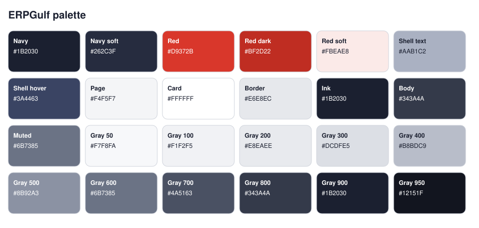
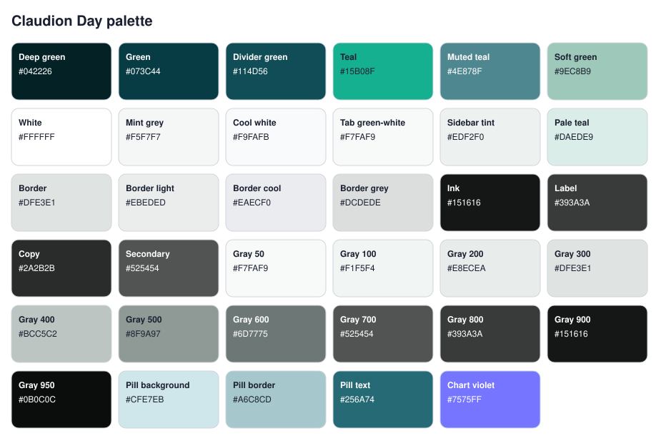
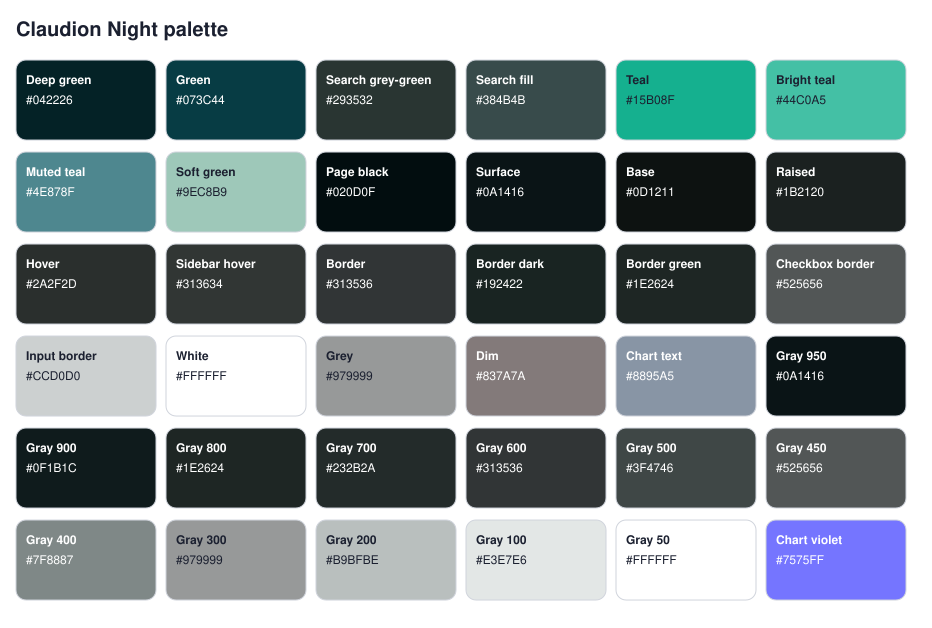

# Design reference

Colours, type and element styling for the three desk themes in this app (Frappe v16.50 and above), taken from the stylesheets as they stand. It is meant for designers: change a value here on paper, and the "In code" column tells a developer where to change it.

All stylesheets are in `erpgulf_themes/public/scss/themes/`.

| Theme | Type | Stylesheet |
| --- | --- | --- |
| [ERPGulf](#erpgulf) | Light | `_erpgulf.scss` |
| [Claudion Day](#claudion-day) | Light | `_day.scss` |
| [Claudion Night](#claudion-night) | Dark | `_night.scss` |

## Typography (all themes)

| Role | Font | Weights | Used for |
| --- | --- | --- | --- |
| Interface | Host Grotesk (variable) | 300–800 | All interface text |
| Display | Young Serif | 400 | ERPGulf theme only: page title and large headings |
| Code | System monospace (SF Mono, Menlo, Consolas…) | — | Code editors and code blocks |

- Arabic and any other script the fonts lack fall back to Frappe's own font stack.
- Font files are in `erpgulf_themes/public/fonts/`. Font variables are at the top of `_base.scss`.

## ERPGulf

Navy shell and sidebar, light-grey page, white cards, red accent. Based on the FoodHub screens.

### Brand and shell

| Name | Hex | In code | Used for |
| --- | --- | --- | --- |
| Navy | `#1B2030` | `$eg-navy` | App frame behind the page, sidebar, dock, avatar background, heading text |
| Navy soft | `#262C3F` | `$eg-navy-soft` | Raised surfaces on the navy shell (menus, collapsed-section tile) |
| Red | `#D9372B` | `$eg-red` | Primary buttons, current sidebar item, focus border, checkboxes, progress bars, date-picker selection |
| Red dark | `#BF2D22` | `$eg-red-dark` | Primary button hover and pressed |
| Red soft | `#FBEAE8` | `$eg-red-soft` | Text selection highlight |
| Shell text | `#AAB1C2` | `$eg-shell-text` | Idle sidebar labels and icons on navy |

### Page and surfaces

| Name | Hex | In code | Used for |
| --- | --- | --- | --- |
| Page | `#F4F5F7` | `$eg-page` | Page background, row hover, read-only inputs, default-button hover |
| Card | `#FFFFFF` | `$eg-card` | Cards, widgets, forms, lists, inputs, modals, page header bar |
| Border | `#E6E8EC` | `$eg-border` | Card, input, table and header borders |

### Text

| Name | Hex | In code | Used for |
| --- | --- | --- | --- |
| Ink | `#1B2030` | `$eg-ink` | Headings, card titles, default-button text |
| Body | `#343A4A` | `$eg-text` | Body text |
| Muted | `#6B7385` | `$eg-muted` | Secondary text, table header labels |

### Grey ramp (drives Frappe's own surface, text and border tokens)

| Name | Hex | In code | Used for |
| --- | --- | --- | --- |
| Gray 50 | `#F7F8FA` | `--gray-50` | — |
| Gray 100 | `#F1F2F5` | `--gray-100` | — |
| Gray 200 | `#E8EAEE` | `--gray-200` | — |
| Gray 300 | `#DCDFE5` | `--gray-300` | — |
| Gray 400 | `#B8BDC9` | `--gray-400` | — |
| Gray 500 | `#8B92A3` | `--gray-500` | — |
| Gray 600 | `#6B7385` | `--gray-600` | — |
| Gray 700 | `#4A5163` | `--gray-700` | — |
| Gray 800 | `#343A4A` | `--gray-800` | — |
| Gray 900 | `#1B2030` | `--gray-900` | — |
| Gray 950 | `#12151F` | `--gray-950` | — |

### Elements

| Element | Background | Text / icon | Border | Radius | Notes |
| --- | --- | --- | --- | --- | --- |
| App frame | `#1B2030` | — | — | — | Shows behind the page's rounded corners |
| Page panel | `#F4F5F7` | `#343A4A` | — | 22px on the sidebar side | The whole content area |
| Page header bar | `#FFFFFF` | `#1B2030`, Young Serif title | 1px `#E6E8EC` bottom | — | Title is the last breadcrumb |
| Sidebar | `#1B2030` | `#AAB1C2` | none | — | |
| Sidebar item, hover | white at 8% | `#FFFFFF` | — | theme radius | |
| Sidebar item, current | `#D9372B` | `#FFFFFF` | — | theme radius | Shadow: 0 6px 16px, red at 35% |
| Dock (module rail) | `#1B2030` | `#AAB1C2` | — | — | |
| Dock tile, hover | white at 8% | `#FFFFFF` | — | — | |
| Dock tile, current module | `#D9372B` | `#FFFFFF` | — | — | Shadow: 0 6px 16px, red at 35% |
| Primary button | `#D9372B` | `#FFFFFF` | `#D9372B` | 10px | Hover and pressed: `#BF2D22`. Applies to classic buttons and to solid buttons from Frappe's new component library |
| Default button | `#FFFFFF` | `#1B2030` | 1px `#E6E8EC` | 10px | Hover: `#F4F5F7` |
| Card, widget, form, list, report | `#FFFFFF` | `#343A4A` | 1px `#E6E8EC` | 16px | No shadow |
| Card and section titles | — | `#1B2030`, weight 600 | — | — | |
| Text input | `#FFFFFF` | `#343A4A` | 1px `#E6E8EC` | 10px | Focus: `#D9372B` border and a 3px ring, red at 15% |
| Read-only input | `#F4F5F7` | — | — | — | |
| Table / list header | `#FFFFFF` | `#6B7385`, weight 500 | — | — | |
| Table / list row, hover | `#F4F5F7` | — | — | — | |
| Modal | `#FFFFFF` | — | — | 18px | |
| Avatar (initials) | `#1B2030` | `#FFFFFF` | — | — | |
| Text selection | `#FBEAE8` | `#1B2030` | — | — | |
| Focus ring, selection in print designer and Kanban | `#D9372B` | — | — | — | Focus ring at 25–50% opacity |

Corner radius scale: 10px (controls), 12px, 14px, 18px (large surfaces); cards 16px; page panel 22px.

Status pills, alerts and charts are not restyled in this theme: they use Frappe's standard colours.

## Claudion Day

White page, deep-green top bar, teal accent.

### Brand and navigation

| Name | Hex | In code | Used for |
| --- | --- | --- | --- |
| Deep green | `#042226` | `--main-color` | Top bar base colour |
| Green | `#073C44` | — | Top bar, secondary buttons, mini chart bars |
| Search green | `#114D56` | `--searchbar-color` | Search box in the top bar, top-bar divider |
| Teal | `#15B08F` | `--accent-color` | Accent: sidebar hover and current item, current dock tile, avatar background, link hover, list-sidebar button hover |
| Muted teal | `#4E878F` | — | Workspace edit / new buttons and their icons |
| Soft green | `#9EC8B9` | `--text-highlight` | Highlight text on dark green |

### Page and surfaces

| Name | Hex | In code | Used for |
| --- | --- | --- | --- |
| White | `#FFFFFF` | `--background-light` | Page background, inputs, text and icons on the green top bar |
| Mint grey | `#F5F7F7` | `--box-color / --card-bg` | Widgets, link cards, dashboard cards |
| Cool white | `#F9FAFB` | — | Form and list card background, table header cells |
| Tab green-white | `#F7FAF9` | — | Form tab strip and form page background |
| Sidebar tint | `#EDF2F0` | — | Form sidebar menu and stats |
| Pale teal | `#DAEDE9` | `--background-color3 / --box2-color` | Dock tile hover, active skipped onboarding step, tinted boxes |

### Borders

| Name | Hex | In code | Used for |
| --- | --- | --- | --- |
| Border | `#DFE3E1` | `--border-color` | Widget and form-page borders |
| Border light | `#EBEDED` | `--border-color3` | Link-card borders |
| Border cool | `#EAECF0` | — | Form / list card border |
| Border grey | `#DCDEDE` | — | Workspace block borders |

### Text

| Name | Hex | In code | Used for |
| --- | --- | --- | --- |
| Ink | `#151616` | `--text-color` | Body text, default-button text, icons |
| Label | `#393A3A` | — | Field labels, form tabs, input text, grid headers |
| Copy | `#2A2B2B` | — | Widget subtitles, link text, onboarding copy |
| Secondary | `#525454` | `--text-color2` | Secondary link text |
| Search text | `#AAB2BD` | — | Search box text and placeholder |

### Grey ramp (drives Frappe's own surface, text and border tokens, so it colours every screen the theme has no specific rule for, including the new v16.50 screens)

| Name | Hex | In code | Used for |
| --- | --- | --- | --- |
| Gray 50 | `#F7FAF9` | `--gray-50` | Subtle backgrounds |
| Gray 100 | `#F1F5F4` | `--gray-100` | Control backgrounds, hover |
| Gray 200 | `#E8ECEA` | `--gray-200` | Light borders |
| Gray 300 | `#DFE3E1` | `--gray-300` | Borders |
| Gray 400 | `#BCC5C2` | `--gray-400` | Strong borders, placeholders |
| Gray 500 | `#8F9A97` | `--gray-500` | Faint text |
| Gray 600 | `#6D7775` | `--gray-600` | Muted text |
| Gray 700 | `#525454` | `--gray-700` | Secondary text |
| Gray 800 | `#393A3A` | `--gray-800` | Labels |
| Gray 900 | `#151616` | `--gray-900` | Body text |
| Gray 950 | `#0B0C0C` | `--gray-950` | Headings |

### Status and charts

| Name | Hex | In code | Used for |
| --- | --- | --- | --- |
| Pill background | `#CFE7EB` | — | Green and blue status pills |
| Pill border | `#A6C8CD` | — | Green and blue status pills |
| Pill text | `#256A74` | — | Green and blue status pills |
| Chart violet | `#7575FF` | — | Line-chart stroke and tooltip marker |

### Elements

| Element | Background | Text / icon | Border | Notes |
| --- | --- | --- | --- | --- |
| Top bar | `#073C44` | `#FFFFFF` | — | |
| Search box (top bar) | `#114D56` | `#AAB2BD` | — | |
| Page | `#FFFFFF` | `#151616` | — | |
| Sidebar item, hover and current | `#15B08F` | `#FFFFFF` | — | Radius 6px |
| Dock tile, hover | `#DAEDE9` | `#042226` | — | |
| Dock tile, current module | `#15B08F` | `#FFFFFF` | — | |
| Avatar (initials) | `#15B08F` | `#FFFFFF` | — | |
| Primary button | `#073C44` | `#FFFFFF` | — | Hover (component-library buttons): `#042226` |
| Default button | — | `#151616` | — | |
| Secondary button | `#073C44` | — | `#073C44` | |
| Checkboxes, progress bars, focus ring, selection in print designer and Kanban | `#15B08F` | — | — | Focus ring at 35–60% opacity |
| Workspace edit / new buttons | — | `#4E878F` | — | |
| Widgets and link cards | `#F5F7F7` | `#2A2B2B` | 1px `#EBEDED` | |
| Form / list card | `#F9FAFB` | — | 1px `#EAECF0` | |
| Form tab strip and form page | `#F7FAF9` | `#393A3A` | 1px `#DFE3E1` | |
| Field labels, grid headers | — | `#393A3A`, weight 500, 12px | — | |
| Text input | `#FFFFFF` | `#393A3A` | — | |
| Status pill (green, blue) | `#CFE7EB` | `#256A74` | 1px `#A6C8CD` | |
| List-sidebar button, hover | `#15B08F` | `#FFFFFF` | `#15B08F` | |
| Line chart | — | stroke `#7575FF` | — | |

Module and sidebar icons are Frappe's own outline icons, coloured by the theme.

## Claudion Night

Near-black green surfaces, teal accent. Runs on top of Frappe's own dark theme, so anything not listed here uses Frappe's dark colours.

### Brand and navigation

| Name | Hex | In code | Used for |
| --- | --- | --- | --- |
| Deep green | `#042226` | — | Top bar |
| Green | `#073C44` | `--main-color` | Link hover on dark, brand green |
| Search grey-green | `#293532` | `--searchbar-color` | Search box base, widget borders |
| Search fill | `#384B4B` | — | Search box background and border |
| Teal | `#15B08F` | `--accent-color` | Accent: links, hover text and icons, focus border, primary-style buttons |
| Bright teal | `#44C0A5` | — | Current sidebar item and current dock tile |
| Muted teal | `#4E878F` | — | Button borders, button text and icons |
| Soft green | `#9EC8B9` | `--text-highlight` | Highlight text |

### Page and surfaces

| Name | Hex | In code | Used for |
| --- | --- | --- | --- |
| Page black | `#020D0F` | — | Page container, page header, input background; text on the bright-teal sidebar item |
| Surface | `#0A1416` | — | Main content area, forms, list header and rows |
| Base | `#0D1211` | `--background-light` | Base background, shown before the page finishes loading |
| Raised | `#1B2120` | `--background-color3` | Onboarding steps, raised boxes |
| Hover | `#2A2F2D` | — | List row hover, link hover background |
| Sidebar hover | `#313634` | — | Sidebar item and dock tile hover |

### Borders

| Name | Hex | In code | Used for |
| --- | --- | --- | --- |
| Border | `#313536` | — | Inputs, filters, form page, cards |
| Border dark | `#192422` | `--border-color` | Top bar and widget borders |
| Border green | `#1E2624` | `--border-color3` | Hovered step border |
| Checkbox border | `#525656` | — | List checkboxes |
| Input border | `#CCD0D0` | — | Text input border |

### Text

| Name | Hex | In code | Used for |
| --- | --- | --- | --- |
| White | `#FFFFFF` | — | Headings, widget titles, input text, form tabs |
| Grey | `#979999` | `--text-light / --text-color3` | Labels, grid headers, secondary text, idle icons |
| Dim | `#837A7A` | — | Truncated text, group-by links |
| Chart text | `#8895A5` | — | Chart axis and legend text |

### Grey ramp (drives Frappe's own surface, text and border tokens, so it colours every screen the theme has no specific rule for, including the new v16.50 screens)

| Name | Hex | In code | Used for |
| --- | --- | --- | --- |
| Gray 950 | `#0A1416` | `--gray-950` | Base surface |
| Gray 900 | `#0F1B1C` | `--gray-900` | Subtle surface |
| Gray 800 | `#1E2624` | `--gray-800` | Subtle borders |
| Gray 700 | `#232B2A` | `--gray-700` | Control backgrounds, hover |
| Gray 600 | `#313536` | `--gray-600` | Raised surfaces, borders |
| Gray 500 | `#3F4746` | `--gray-500` | Strong borders |
| Gray 450 | `#525656` | `--gray-450` | Stronger borders |
| Gray 400 | `#7F8887` | `--gray-400` | Muted text |
| Gray 300 | `#979999` | `--gray-300` | Secondary text |
| Gray 200 | `#B9BFBE` | `--gray-200` | Strong secondary text |
| Gray 100 | `#E3E7E6` | `--gray-100` | Body text |
| Gray 50 | `#FFFFFF` | `--gray-50` | Headings |

### Charts

| Name | Hex | In code | Used for |
| --- | --- | --- | --- |
| Chart violet | `#7575FF` | — | Line-chart stroke and tooltip marker |

### Elements

| Element | Background | Text / icon | Border | Notes |
| --- | --- | --- | --- | --- |
| Top bar | `#042226` | `#979999` | `#192422` | |
| Search box (top bar) | `#384B4B` | — | `#384B4B` | |
| Page container and header | `#020D0F` | `#979999` | — | |
| Main content, forms, lists | `#0A1416` | `#FFFFFF` | 1px `#313536` | |
| Sidebar item, hover | `#313634` | `#FFFFFF`, icon `#15B08F` | — | |
| Sidebar item, current | `#44C0A5` | `#020D0F` | — | |
| Dock tile, hover | `#313634` | `#FFFFFF` | — | |
| Dock tile, current module | `#44C0A5` | `#020D0F` | — | |
| Buttons (default, icon, primary) | — | `#4E878F` | 1px `#4E878F` | |
| Accent buttons (secondary, new document) | `#15B08F` | — | — | |
| Primary button (page action, component-library solid buttons) | `#4E878F` | `#FFFFFF` | — | Hover: `#5C98A0` |
| Checkboxes, progress bars, focus ring, selection in print designer and Kanban | `#15B08F` | — | — | Focus ring at 40–60% opacity |
| Text input | `#020D0F` | `#FFFFFF` | 1px `#CCD0D0` | Filters and inline inputs: 1px `#313536` |
| Field labels, grid headers | — | `#979999` | — | |
| Headings, widget titles | — | `#FFFFFF` | — | |
| Links | — | `#15B08F` | — | Hover: `#073C44` |
| List row, hover | `#2A2F2D` | — | — | |
| List checkbox | `#0A1416` | — | `#525656` | |
| Onboarding step | `#1B2120` | `#979999` | — | Hover border `#1E2624` |
| Chart axis and legend text | — | `#8895A5` | — | |
| Line chart | — | stroke `#7575FF` | — | |

Module and sidebar icons are Frappe's own outline icons, coloured by the theme.

## Screens without their own rules

The print designer, DocType Settings, the data import wizard, Kanban boards, list layouts, global search and the new component library are drawn entirely from Frappe's colour tokens. Each theme remaps those tokens (the grey ramp and the accent) at the top of its stylesheet, so these screens follow the theme without screen-by-screen rules. To restyle them, change the ramp or the accent.

## Changing a colour

- **ERPGulf:** every colour is a variable at the top of `_erpgulf.scss` (`$eg-…`) or in the grey ramp just below it. Change it there and it applies everywhere.
- **Claudion Day and Night:** the grey ramp and accent are in the "Frappe tokens" block at the top of each stylesheet. Other colours with a name in the "In code" column are variables just below it. The rest (shown as —) are written directly into individual rules, so changing one means a find-and-replace of the hex value in that stylesheet.
- After any change: `bench build --app erpgulf_themes`.
